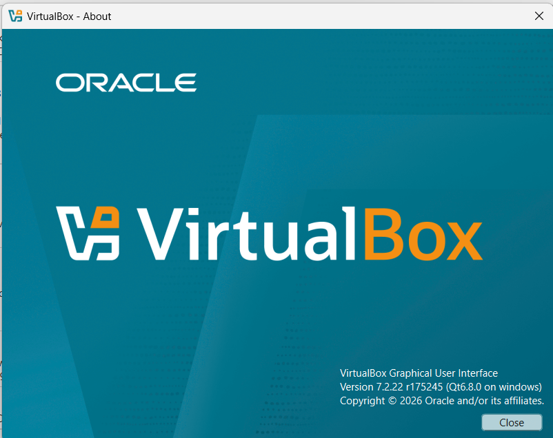
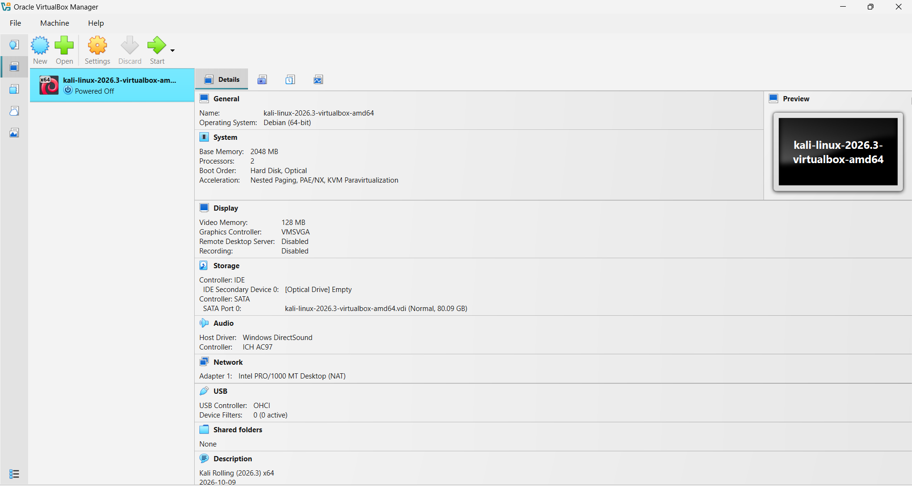
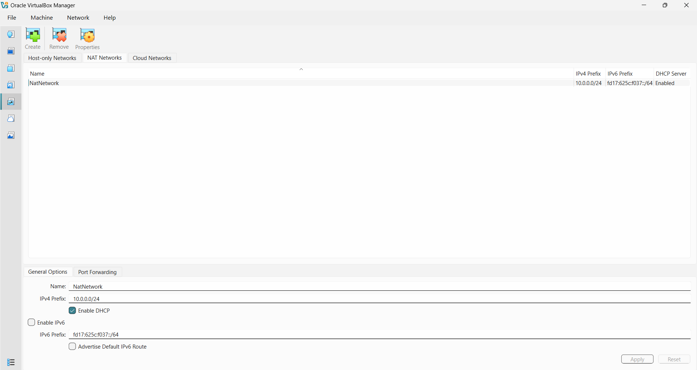
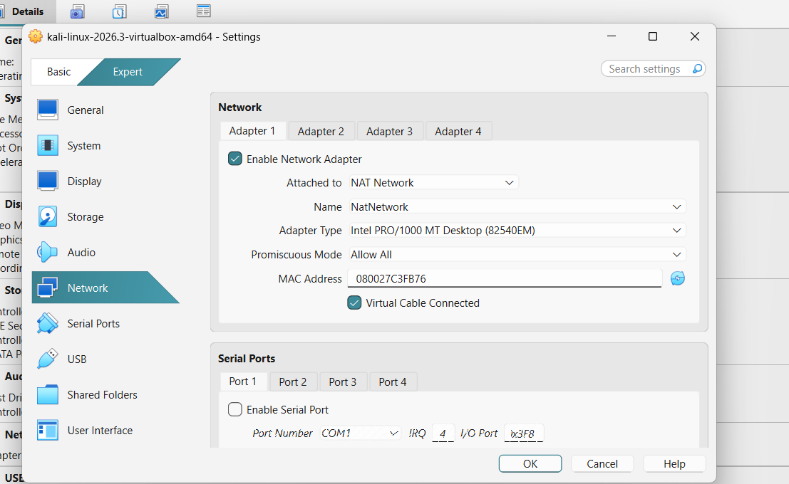
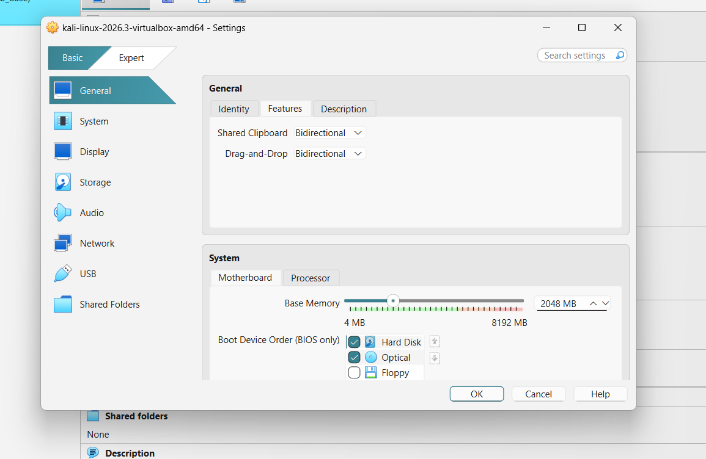
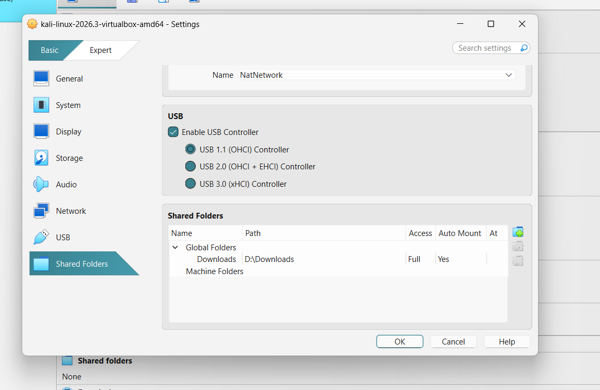
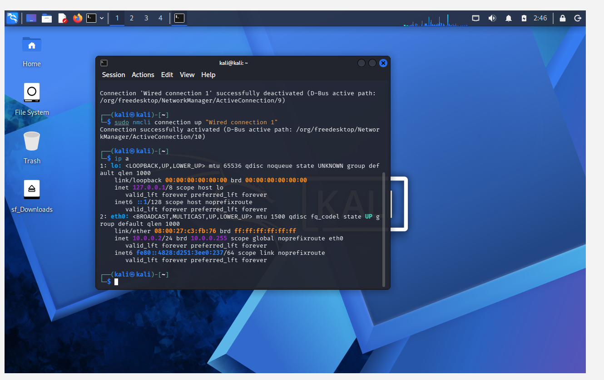
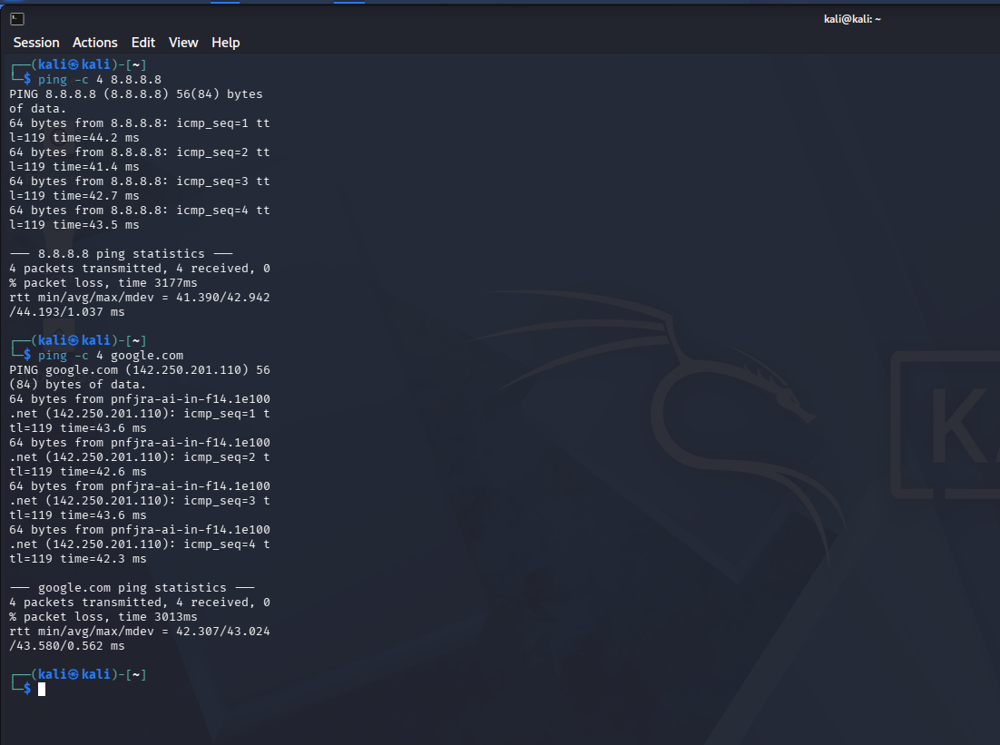
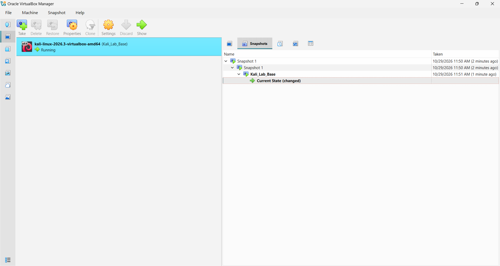

# Cybersecurity Lab Environment Setup

Building an isolated virtual lab for ethical hacking and penetration-testing practice.

    

---

## Project Overview

This project covers Week 1 (WK1-PM1) of the Networkwalks Cybersecurity Program (Batch B084).

The goal is to build a safe, isolated virtual lab on my own laptop where security tools and techniques can be practiced legally and repeatedly. The lab uses **VirtualBox** as the virtualization platform and **Kali Linux** as the attacker machine, connected through a private **NAT Network (10.0.0.0/24)**. Other machines can be added later as practice targets.

> **Disclaimer:** This lab is for education only. All testing is done on my own devices and virtual machines. Never test systems without written permission from the owner.

---

## Lab Requirements

| Requirement | Status |
|---|---|
| VirtualBox as base (latest version) | Done |
| Kali Linux as attacker machine | Done |
| NAT Network with subnet 10.0.0.0/24 | Done |
| Clipboard and drag/drop enabled | Done |
| Shared folder (host Downloads) enabled | Done |
| Kali IP address 10.0.0.2/24 | Done |
| Full Internet access from Kali | Done |
| Snapshot of the VM | Done |

---

## Tools Used

| Tool | Version |
|---|---|
| Host OS | Windows 11 |
| VirtualBox | 7.2.22 |
| Kali Linux | 2026.3 (pre-built VirtualBox image) |
| 7-Zip | Used to extract the Kali image |

---

## Network Design

```
Host Machine (Windows)
  |
  +-- VirtualBox
        |
        +-- NAT Network: NatNetwork (10.0.0.0/24)
              |
              +-- Kali Linux  ->  10.0.0.2/24
                  Gateway     ->  10.0.0.1
                  DNS         ->  8.8.8.8
```

---

## Step-by-Step Setup

### Step 1: Install VirtualBox

I downloaded the latest VirtualBox from the official website and installed it on the host machine.



### Step 2: Download and import Kali Linux

I downloaded the pre-built Kali Linux VirtualBox image from the official Kali website, extracted it with 7-Zip, and imported it into VirtualBox by opening the `.vbox` file.



### Step 3: Create the NAT Network

In VirtualBox, I opened the Network manager, selected the **NAT Networks** tab, and created a new network:

- Name: `NatNetwork`
- IPv4 Prefix: `10.0.0.0/24`
- DHCP: Enabled



### Step 4: Attach Kali to the NAT Network

In the Kali VM settings, I opened **Network > Adapter 1** and set:

- Attached to: `NAT Network`
- Name: `NatNetwork`
- Promiscuous Mode: `Allow All`



### Step 5: Enable clipboard and drag/drop

In **Settings > General > Features**, I set both **Shared Clipboard** and **Drag-and-Drop** to `Bidirectional`.



### Step 6: Enable the shared folder

In **Settings > Shared Folders**, I added the host `Downloads` folder as a global shared folder with **Auto-mount** enabled. Inside Kali it appears as `sf_Downloads`.



### Step 7: Set the static IP address in Kali

Inside Kali, I opened **Edit Connections > Wired connection 1 > IPv4 Settings** and configured:

- Method: `Manual`
- Address: `10.0.0.2`
- Netmask: `24`
- Gateway: `10.0.0.1`
- DNS: `8.8.8.8`


### Step 8: Verify the configuration

I verified the IP address and Internet access from the Kali terminal:

```bash
ip a
ping -c 4 8.8.8.8
ping -c 4 google.com
```

The `ip a` output shows `10.0.0.2/24` on `eth0`.



Both ping tests succeeded with 0% packet loss, which confirms full Internet access.



### Step 9: Take a snapshot

I took a snapshot named `Kali_Lab_Base` so I can restore this clean, working state at any time.



---

## Verification Results

- Kali IP address is `10.0.0.2/24`
- Kali can reach the Internet (ping to 8.8.8.8 and google.com works with 0% packet loss)
- Clipboard and drag/drop are set to Bidirectional
- Host Downloads folder is shared and visible in Kali as `sf_Downloads`
- Snapshot `Kali_Lab_Base` created

---

## Troubleshooting

**Problem:** After setting the static IP (10.0.0.2) in Kali Linux, the IP address was not applied. The `ip a` output showed only an IPv6 address on `eth0`.

**Solution:** I ran the commands below and restarted the connection. After that, `ip a` showed `10.0.0.2/24` and the Internet worked (ping to 8.8.8.8 and google.com succeeded).

```bash
sudo nmcli connection modify "Wired connection 1" ipv4.dad-timeout 0
sudo nmcli connection down "Wired connection 1"
sudo nmcli connection up "Wired connection 1"
```

---

## Key Learnings

- How to build an isolated lab using a NAT Network
- How to assign and verify a static IP address on Linux
- How snapshots protect a working lab setup
- Why labs must be isolated and used only with permission

---

## Next Steps

- Add Windows and Android virtual machines as practice targets
- Practice network scanning and reconnaissance in the lab
- Continue with the next weekly projects

---

*Part of the Networkwalks Cybersecurity Program, Batch B084.*
